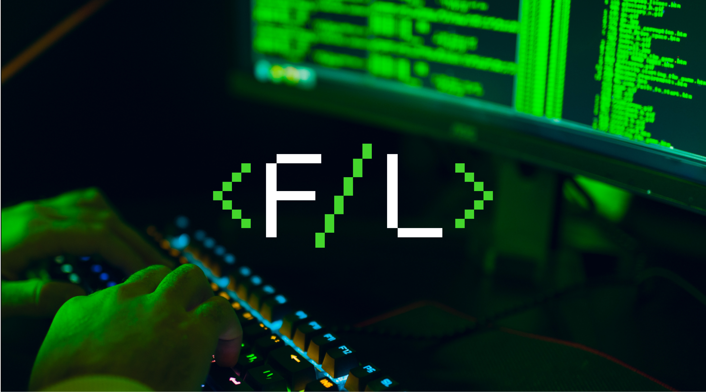

<div align="center">
  

  # `<F/L>` Fábio Lucas — Portfólio, E-books & Cursos

  **Desenvolvedor Flutter | Full-Stack & Cloud Architect**

  [](https://flutter.dev)
  [](https://dart.dev)
  [](https://firebase.google.com)
  [](https://cloud.google.com)
  [](https://react.dev)
  [](https://www.typescriptlang.org/)
  [](https://vitejs.dev)
</div>

---

## 👨‍💻 Sobre o Projeto

Plataforma oficial de portfólio, produtos digitais (E-books), formação técnica (Cursos) e comunidade de **Fábio Lucas Pereira Ferreira** — Desenvolvedor Full-Stack especializado na construção de ecossistemas móveis e web de alta disponibilidade com **Flutter**, **Firebase**, **Google Cloud Platform (GCP)**, **Cloud Functions** e **WhatsApp Business API**.

---

## 🚀 Principais Case Studies & Ecossistemas

### 1. 🟢 GynMove & Volt Finance (Mobilidade Urbana 3D & Fintech)
Ecossistema integrado de mobilidade e inteligência financeira sob o projeto mestre `gynmove-fde7e`:
- **Algoritmo de Relevo 3D**: Integração com **Google Routes API** e **Google Elevation API** para cálculo do esforço físico real da rota (subidas `> 10%` com +25% de consumo; descidas `< -10%` com Cut-Off eletrônico de -25% e economia Start-Stop).
- **Gestão de Custos Invisíveis**: Amortização automática de **R$ 0,16/km** (Kit Revisão, Pneus/Suspensão e Higienização) em reserva virtual.
- **Arquitetura Clean & Wasm**: Zero pacotes externos de gerenciamento de estado (`StatefulWidget` nativo), proteção contra *ChannelBuffer overflow* no bootstrap (`ui.channelBuffers.resize('flutter/lifecycle', 20)`) e renderização acelerada via **skwasm** (WebAssembly).
- **Modelagem Unificada**: Cadastro único reativo (`/usuarios/{uid}`) integrando **GynMove Passageiro**, **GynMove Motorista** (com telemetria de cabine por IA) e **Volt Finance** (isolamento estrito entre Carteira PJ e Carteira PF via Pró-labore e controle de guias DAS MEI).

### 2. 🐾 Bicho Mimado (ERP Veterinário & App Taxi Dog)
- ERP completo de gestão clínica veterinária e pet shop.
- Aplicativo do cliente com rastreamento **Taxi Dog em tempo real** via Google Maps SDK.
- Automação de agendamentos e triagem via **WhatsApp Business API**.

### 3. 🍍 PineapplePay (Fintech Mobile)
- Plataforma financeira mobile com **mais de 600 telas** e **+20 fluxos de autenticação**.
- Integração nativa com gateway **Pagar.me**, split de pagamentos e arquitetura de alta segurança.

### 4. ⚖️ CONPER (Gestão de Contratos & Automação Jurídica)
- Sistema multiplataforma (Web, Android, iOS e macOS) com **+110 mil linhas de código**.
- Assinatura digital com validade jurídica via **DocuSign API** e orquestração serverless com Cloud Functions.

### 5. 🔧 AutoPartsGuide, 44GYN, SmartDrop & CFC Focus
- **AutoPartsGuide**: Marketplace automotivo com filtros em tempo real e +400 mil itens homologados.
- **44GYN**: E-commerce para o polo comercial da 44 em Goiânia com roteirização de entregas e chat integrado.
- **SmartDrop**: Operação de dropshipping automatizado com *web scraping* diário via Cloud Functions.
- **CFC Focus**: Plataforma gamificada para autoescolas integrada à API do Detran.

---

## 📱 Experiência Exclusiva do Cliente (`F/L App`)

O portfólio apresenta a metodologia de trabalho em 6 etapas (**Estratégia → Escopo → Estrutura → Esqueleto → Interface → Desenvolvimento**) conectada ao **Portal do Cliente**:
- **Integração GitHub**: Push notifications em tempo real a cada novo commit no repositório do projeto.
- **Feed Semanal & Updates**: Resumo automatizado de milestones com gravações de tela.
- **Agendamento & Transcrição com IA**: Marcação direta de reuniões na agenda e transcrição automatizada com **TensorFlow** pesquisável por palavras-chave.

---

## 🛠️ Stack Tecnológica do Portfólio

- **Frontend**: React 19, TypeScript, Tailwind CSS, Lucide Icons, Framer Motion, DotLottie
- **Roteamento**: React Router DOM v6 (`HashRouter` para compatibilidade universal em SPA)
- **Bundler**: Vite 6
- **Infraestrutura & Deploy**: GitHub Pages (CI/CD via GitHub Actions + branch `gh-pages`) & Firebase Hosting

---

## 💻 Como Executar Localmente

### Pré-requisitos
- **Node.js** (v18 ou superior)
- **npm**

### Passo a Passo

1. Clone o repositório:
   ```bash
   git clone https://github.com/fabiolucasp/fabiolucas.git
   cd fabiolucas
   ```

2. Instale as dependências:
   ```bash
   npm install
   ```

3. Inicie o servidor de desenvolvimento:
   ```bash
   npm run dev
   ```

4. Gere a build de produção:
   ```bash
   npm run build
   ```

---

## 📬 Contato & Redes

- **Portfólio Oficial**: [fabiolucas.com](https://fabiolucas.com)
- **LinkedIn**: [Fábio Lucas Pereira Ferreira](https://www.linkedin.com/in/f%C3%A1bio-lucas-pereira-ferreira-71988b35/)
- **GitHub**: [@fabiolucasp](https://github.com/fabiolucasp)
- **Instagram**: [@fabiolucasdev](https://www.instagram.com/fabiolucasdev/)
- **Stack Overflow**: [Fábio Lucas](https://stackoverflow.com/users/15344910/f%C3%A1bio-lucas)
- **E-mail**: [fabio@fabiolucas.com](mailto:fabio@fabiolucas.com)
- **Localização**: Goiânia, GO — Brasil

---

<div align="center">
  <sub>© Fábio Lucas Pereira Ferreira. Desenvolvido com princípios de Clean Architecture.</sub>
</div>
